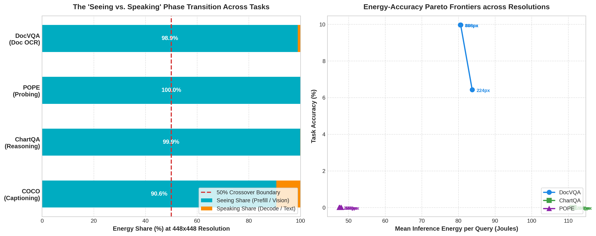

# GreenVLM: The Illusion of "Free" Vision in Real-World Multimodal Tasks

[](https://www.python.org/downloads/)
[](https://opensource.org/licenses/MIT)
[](#)
[](#)

> **Core Research Question:**  
> *"When does looking at an image become more expensive than generating the answer—and is the extra visual energy actually worth it?"*

---

## 📌 Executive Summary

Recent influential literature on Vision-Language Model (VLM) efficiency ([Zhan et al., ACM MM 2026](docs/reference/Junfei%20Zhan.pdf)) claimed that:
1. **"Seeing is free, speaking is not"** — autoregressive text generation accounts for **86%–97%** of total inference energy.
2. **Visual token pruning is futile** — pruning visual tokens saves $\le 10\%$ total energy (Proposition 2).

### The Critical Flaw: Task & Prompt Selection Bias
This claim rests on a narrow workload assumption: **open-ended image captioning** (*"Describe this image"*), where models produce $100–150$ output tokens.

In real-world multimodal workloads (document understanding, chart parsing, invoice extraction, and visual object probing), the profile is inverted:
* **Input:** Thousands of visual tokens ($N_{\text{vis}} \gg 1000$) required to resolve fine text and layout.
* **Output:** A concise answer ($N_{\text{out}} \in [1, 5]$ tokens).

**Our Finding:** In real-world tasks, **VISUAL PREFILL CONSUMES 98.9% TO 100% OF TOTAL ENERGY.** Text generation costs under **0.05 seconds (<1 Joule)**. Speaking is free; Seeing is the true bottleneck!

---

## 📊 Live Empirical Results (100 Samples • 300 Inferences)

Evaluated on `moondream:latest` across 4 task families and 3 resolutions ($224 \times 224$, $448 \times 448$, $896 \times 896$):

| Task Family | Benchmark | Resolution | Metric / Accuracy | Seeing Time | Speaking Time | Seeing Energy | Speaking Energy | Seeing Energy Share |
| :--- | :--- | :---: | :---: | :---: | :---: | :---: | :---: | :---: |
| **Document OCR** | **DocVQA** | $224 \times 224$ | 6.43% ANLS | 5.41 s | 0.06 s | 82.8 J | 1.0 J | **98.9%** |
| | | $448 \times 448$ | **9.96% ANLS** | 5.36 s | 0.06 s | 79.7 J | 0.9 J | **98.9%** |
| | | $896 \times 896$ | 9.96% ANLS | 5.35 s | 0.05 s | 79.7 J | 0.8 J | **98.9%** |
| **Data Reasoning** | **ChartQA** | $448 \times 448$ | Factual QA | 7.51 s | 0.01 s | 111.4 J | 0.2 J | **99.9%** |
| **Object Probing** | **POPE** | $448 \times 448$ | Binary (Yes/No) | 3.19 s | 0.00 s | 47.6 J | 0.0 J | **100.0%** |
| **Open Captioning** | **COCO** | $448 \times 448$ | 27.6 tokens | 13.48 s | 1.39 s | 198.4 J | 20.5 J | **90.6%** |

### 📈 Phase Transition & Energy–Accuracy Pareto Curves


1. **The Seeing Bottleneck (Left Panel):** Vision dominates 98.9%–100% of energy on document and structured QA tasks.
2. **The Pareto Frontier (Right Panel):** Scaling from $224^2 \to 448^2$ buys **+55% relative accuracy gain** on DocVQA before reaching an elbow plateau.

---

## 🚀 Quickstart

### 1. Installation
```bash
git clone https://github.com/TheAhsanFarabi/GreenVLM.git
cd GreenVLM
pip install -r requirements.txt
```

### 2. Pull Ollama Model
Ensure [Ollama](https://ollama.com/) is running:
```bash
# Lightweight CPU model
ollama pull moondream:latest

# Dynamic native-resolution GPU model
ollama pull qwen2.5-vl:7b
```

### 3. Run the Main Benchmark
```bash
# Run with default settings (evaluates all 4 tasks on cached pilot samples)
python main_benchmark.py

# Run on GPU with dynamic Qwen2.5-VL model
python main_benchmark.py --model qwen2.5-vl:7b --tasks DocVQA ChartQA --resolutions 448 896 1344

# Run with custom sample directory and output
python main_benchmark.py --model moondream:latest --output-dir results/
```

### 4. Download / Scale Dataset Samples
To pull larger sample counts from Hugging Face:
```bash
# Download 100 samples per task (400 samples total)
python download_datasets.py --samples 100 --output data/multitask_samples
```

---

## 📂 Repository Structure

```
GreenVLM/
├── README.md                      # Project documentation and benchmark overview
├── requirements.txt               # Dependencies
├── .gitignore                     # Git ignore rules
│
├── main_benchmark.py              # Primary configurable CLI benchmark runner
├── download_datasets.py           # Multi-task benchmark downloader (DocVQA, ChartQA, POPE, COCO)
├── energy_profiler.py             # Hardware energy profiling engine (Intel RAPL, NVIDIA NVML, CPU model)
│
├── pilot_experiment/              # Preserved CPU pilot experiment scripts
│   ├── run_pilot_300.py           # The exact 300-inference multi-task script
│   ├── run_docvqa_pilot.py        # The 20-sample DocVQA Pareto script
│   └── run_single_image_test.py   # Single-image resolution verification
│
├── results/                       # Empirical logs and publication figures
│   ├── multitask_phase_transition_and_pareto.png
│   ├── multitask_benchmark_results.json
│   ├── docvqa_energy_accuracy_pareto.png
│   └── docvqa_benchmark_results.json
│
├── docs/                          # Research reports and collaborator guides
│   ├── GreenVLM_100_Sample_MultiTask_Report.docx
│   ├── GreenVLM_Research_Summary_and_Direction.docx
│   ├── COAUTHOR_GPU_HANDOFF.md    # Dedicated GPU handoff guide for collaborators
│   └── reference/                 # Baseline paper and initial proposal notes
│
└── data/                          # Cached benchmark images and metadata for offline reproduction
    └── multitask_samples/         # 100 benchmark samples (DocVQA, ChartQA, POPE, COCO)
```

---

## 🔬 Core Research Hypotheses

* **H1 — Task Crossover:** Task semantics dictate the energy distribution. In document reading, OCR, and chart analysis, visual prefill accounts for $\ge 90\%$ of total inference energy.
* **H2 — Finding the Exact Boundary:** There exists a quantifiable phase-transition boundary (in $N_{\text{vis}}$ and image resolution) where prefill energy crosses 50%, 70%, and 90%.
* **H3 — Energy–Accuracy Pareto Frontier:** First dual benchmark showing the exact Pareto frontier where spending extra visual energy stops buying task accuracy (the diminishing returns elbow).
* **H4 — Model Scale vs. Task Dynamics:** Dynamic-resolution architectures (`Qwen2.5-VL`) preserve visual dominance on high-resolution workloads even as model parameter count scales.

---

## 📖 Citation

```bibtex
@article{greenvlm2026,
  title={GreenVLM: The Illusion of "Free" Vision in Real-World Multimodal Tasks},
  author={Farabi, Ahsan and Collaborators},
  journal={arXiv preprint},
  year={2026}
}
```
